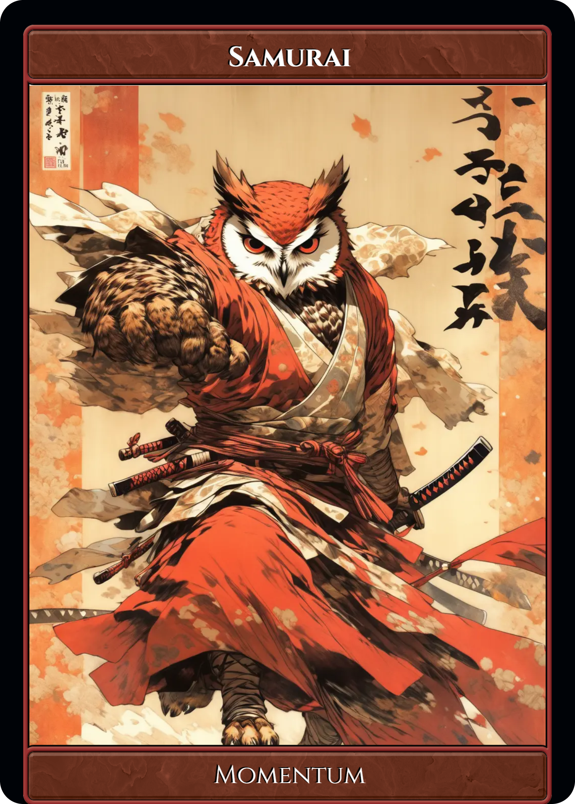

# HeroDraft

HeroDraft is a Discord bot, not a web app: you add it to a server, and
players issue text commands and click buttons inside a channel. One player
challenges another; the bot splits a pool of 15 heroes between them, and
they fight it out over several turns, each one rendered as a generated
combat-card image posted to the channel.

- [Features](features.md): the commands, buttons and what each turn does.
- [Contributing](contributing.md): running the bot locally, its layout, what has no tests.
- [History](history.md): a one-day build, then a card-art polish pass six weeks later.
- [Trivia](trivia.md)

## Trivia

The interactive hero draft the bot's commands are named for — `!herodraft3`,
`!herodraft5` — has never actually run: a flag that skips it in favor of a
random split has been hardcoded on since the first working commit
([history](history.md#one-day-then-six-weeks-later)).
